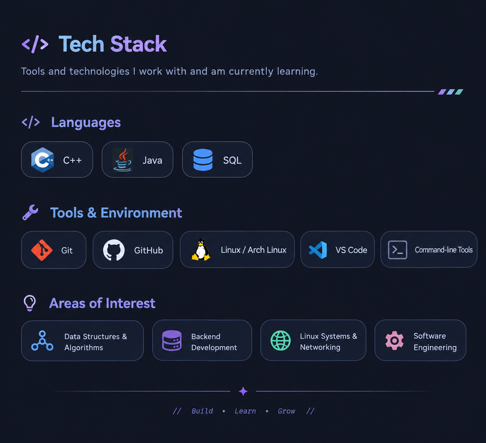

# Hi, I'm Rishav Saha 👋

**B.Tech Computer Science & Engineering Student**

Interested in software development, data structures and algorithms, backend engineering, and Linux systems.

[GitHub](https://github.com/rishav12s) · [LeetCode Solutions](https://github.com/rishav12s/leetcode)

---

## 👨‍💻 About Me

I'm a Computer Science undergraduate who enjoys understanding how things work under the hood, solving problems, and building practical projects while strengthening my software engineering fundamentals.

- 💻 Currently focused on **C++ and Data Structures & Algorithms**
- 🛠️ Exploring **backend development, databases, and systems programming**
- 🐧 Linux enthusiast interested in operating systems, command-line tools, and desktop customization
- 📚 Learning by building projects, solving problems, and revisiting core concepts

## 🧰 Tech Stack

  

## 🚀 Featured Projects

### [Packet Analyzer](https://github.com/rishav12s/Packet_Analyzer)
A networking-focused project exploring packet analysis and computer networking fundamentals.

### [UPI Without Internet](https://github.com/rishav12s/UPI_Without_Internet)
A project exploring the concept of enabling UPI-style payment workflows without conventional internet connectivity.

### [Containerized Vector Database with RAG](https://github.com/rishav12s/VectorDB-with-RAG-Containerised)
A project exploring vector databases, retrieval-augmented generation (RAG), and containerized deployment.

## 🧠 Problem Solving

I practice Data Structures & Algorithms to strengthen my problem-solving skills and build a deeper understanding of algorithmic thinking.

- **Primary language:** C++
- **Focus:** Arrays, Two Pointers, Sliding Window, Binary Search, and other core DSA patterns
- **Approach:** Understand the underlying pattern, analyze time and space complexity, and revisit problems for revision

🔗 **[Explore my LeetCode solutions](https://github.com/rishav12s/leetcode)**

## 📊 Stats

<!-- Paste your GitHub stats, streak, and language-card links below. -->
<!-- GitHub stats card -->

<!-- GitHub streak card -->

<!-- Top languages card -->

## 🐧 Beyond the Code

Outside of development and DSA, I enjoy exploring the Linux ecosystem, customizing desktop environments, and learning more about how software and operating systems work.

- 🖥️ Arch Linux and desktop customization
- ⚙️ Linux workflows, shell tools, and configuration
- 🎨 UI theming and desktop aesthetics
- 🎮 Single-player games and exploring game worlds

## 🤝 Let's Connect

- **GitHub:** [rishav12s](https://github.com/rishav12s)
- **Email:** [Rishav Saha](rishavsaha20.pkt@gmail.com)

---

*Building a stronger foundation, one problem and one project at a time.* ✨

